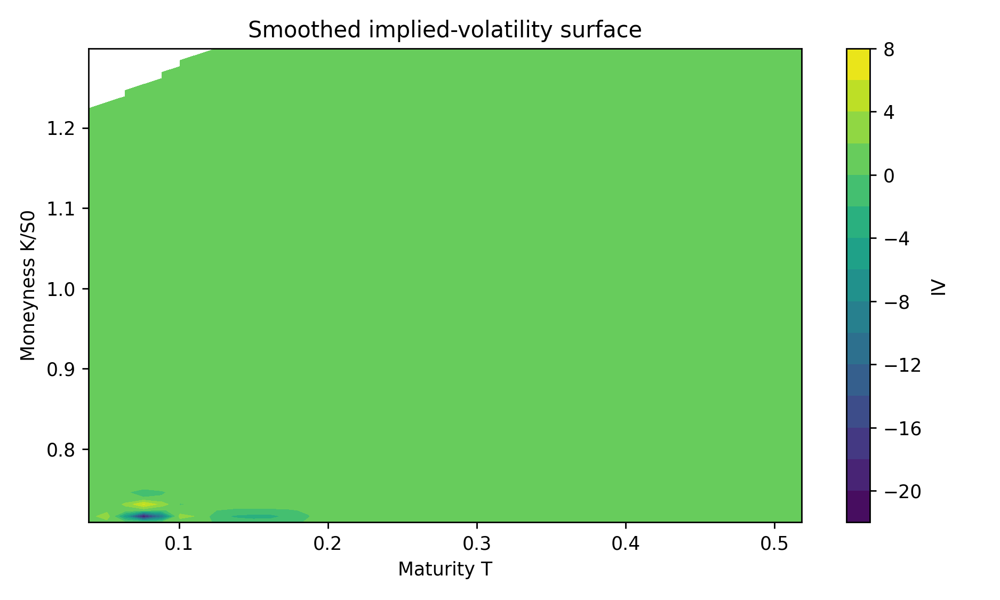
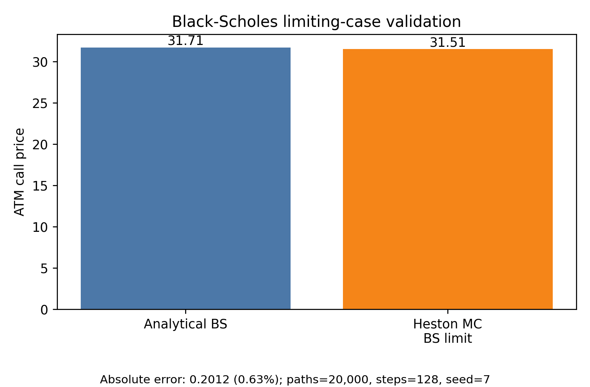

# Heston Stochastic Volatility Calibration to Equity Option Markets

This repository builds a reproducible pipeline from listed AAPL option quotes to a calibrated Heston stochastic-volatility model. It cleans and validates the option chain, reconstructs the implied-volatility smile and surface, verifies the Monte Carlo pricing engine in a Black-Scholes limiting case, and fits Heston parameters to a market smile in implied-volatility space.

For the canonical run saved in this repository, the calibrated single-expiry Heston model fits the central AAPL smile for the 2027-01-15 expiry with an IV RMSE of 1.57 volatility points. The fit matches the broad volatility level, but it smooths over the local hump around the lower-middle strikes; the largest residual is near the 321 strike.


## Results at a Glance

| Item | Canonical run |
| --- | --- |
| Underlying | AAPL |
| Market snapshot | Yahoo Finance option-chain pull saved on 2026-10-08 at 21:43 IST |
| Spot used | 338.72 |
| Data scope | 592 cleaned option observations across 10 expiries |
| Expiry range | 2026-10-23 to 2027-04-16 |
| Calibration target | 2027-01-15 expiry, T = 0.2692 years, 15 central strikes |
| Target moneyness | 0.89 to 1.15 |
| Fitted Heston parameters | v0 = 0.0708, kappa = 2.0000, theta = 0.0423, sigma = 0.3000, rho = -0.7000 |
| Fit quality | IV RMSE = 0.0157, MAE = 0.0134, max absolute residual = 0.0301 |
| Validation | Black-Scholes-limit MC error = 0.2012 price units, or 0.63% of the analytical ATM call price |
| Compute | CPU, 6,000 paths and 60 steps during calibration, seed = 42 |

## Project Question

Can a stochastic-volatility model reproduce the shape of an observed equity option implied-volatility smile, and how do the fitted parameters connect to option risk? Black-Scholes can invert market prices into implied volatilities, but a single constant volatility cannot explain the observed skew and curvature across strikes. Heston introduces stochastic variance and spot/variance correlation, giving a compact model for equity-option smiles.

## Pipeline

1. Market data: download AAPL calls, puts, and underlying spot from `yfinance`.
2. Quote cleaning: construct midpoint prices and filter invalid, illiquid, and extreme-moneyness quotes.
3. Validation: reprice quoted IVs with Black-Scholes and diagnose put-call parity by expiry.
4. Volatility representation: smooth per-expiry smiles and combine them into an implied-volatility surface.
5. Numerical model: simulate Heston paths and validate the engine in the Black-Scholes limiting case.
6. Calibration: fit v0, kappa, theta, sigma, and rho to a selected market smile by minimizing IV error.
7. Evaluation: report residuals, interpret fitted parameters, and state model/data limitations.

## Data and Cleaning

The canonical run retains options with positive midpoint prices, positive open interest, implied volatility between 1% and 250%, and moneyness between 0.70 and 1.30. The cleaned snapshot contains 592 observations and 256 call/put strike-expiry pairs for parity diagnostics. Repricing each cleaned quote from its listed implied volatility gives a median absolute price error of 0.1053 under the zero-rate check; after expiry-level parity inference, the median parity residual is 0.0572.


The market data show a visible volatility skew/smile that varies by maturity. The very short expiries are noisier, while the medium-dated smiles provide a more stable target for a compact Heston calibration.

## Model and Methodology

The project uses Black-Scholes for pricing, Greeks, implied-volatility inversion, and validation diagnostics. The Heston dynamics are:

```text
dS_t = (r - q) S_t dt + sqrt(v_t) S_t dW_t^S
dv_t = kappa(theta - v_t) dt + sigma sqrt(v_t) dW_t^v
corr(dW_t^S, dW_t^v) = rho
```

The Monte Carlo engine uses full truncation for variance and common random seeds during calibration. The calibration objective minimizes mean squared error between target implied volatilities and model-implied volatilities for the selected smile.

## Results



The smoothed surface summarizes the cleaned option chain across maturity and moneyness. It is used as a stable representation of the market quotes rather than as a claim that every raw quote is arbitrage-free.



When sigma is set to zero and v0 equals theta, the Heston simulation collapses to the Black-Scholes case. For the saved validation run, the Monte Carlo ATM call price differs from the analytical Black-Scholes price by 0.2012, or 0.63%.


The selected 2027-01-15 smile is fit over central moneyness from 0.89 to 1.15. The IV RMSE is 1.57 volatility points, with a maximum absolute residual of 3.01 volatility points. Residuals are systematic: the model under-fits the local hump around strikes 314-327 and over-fits much of the right side, which is consistent with the limitation of fitting one maturity with a moderate-path Monte Carlo calibration rather than a fully weighted surface calibration.

## Interpretation

The fitted initial variance v0 = 0.0708 is higher than the long-run variance theta = 0.0423, indicating that the selected market smile embeds near-term variance above the model's long-run level. The negative rho = -0.7000 is consistent with the equity leverage effect, where downside spot moves are associated with higher variance and a left-skewed smile. In this compact run, kappa, sigma, and rho remain at their starting values, so the most reliable empirical statement is about the variance level and residual pattern rather than full identification of every Heston parameter.

## Validation and Limitations

- `yfinance` quotes are convenient but not institutional-quality market data.
- The showcased calibration is a single-expiry, central-smile demonstration.
- Monte Carlo calibration is noisy and slower than characteristic-function pricing.
- Expiry-level rate and dividend estimates inferred from parity can be noisy when quotes are illiquid.
- Parameter identification is limited in a one-smile calibration; multi-expiry weighted calibration would better identify mean reversion and volatility-of-volatility.

## Reproducibility

```bash
python -m venv .venv
source .venv/bin/activate
pip install -r requirements.txt
python -m pytest -q
```

The recommended reviewer path is:

1. `notebooks/01_data_and_option_surface.ipynb`
2. `notebooks/02_black_scholes_greeks_and_scenarios.ipynb`
3. `notebooks/03_heston_monte_carlo.ipynb`
4. `notebooks/04_heston_calibration.ipynb`

The archival notebook `notebooks/00_original_exploration.ipynb` preserves the initial exploratory work and is not required for review. The canonical snapshot used for the results above is saved under `data/sample/`, while the fixed run record is in `reports/run_summary.md`.

## Repository Map

```text
.
├── README.md
├── requirements.txt
├── notebooks/
│   ├── 00_original_exploration.ipynb
│   ├── 01_data_and_option_surface.ipynb
│   ├── 02_black_scholes_greeks_and_scenarios.ipynb
│   ├── 03_heston_monte_carlo.ipynb
│   └── 04_heston_calibration.ipynb
├── src/
│   ├── data.py
│   ├── black_scholes.py
│   ├── validation.py
│   ├── heston.py
│   ├── calibration.py
│   └── plotting.py
├── data/
│   ├── raw/
│   ├── processed/
│   └── sample/
├── reports/
│   ├── figures/
│   ├── calibration_residuals.csv
│   ├── canonical_run_metrics.json
│   └── run_summary.md
└── tests/
    ├── test_black_scholes.py
    └── test_heston.py
```

## Extensions

- Calibrate across multiple expiries with weighted IV error.
- Compare Monte Carlo calibration with a semi-closed-form Heston pricer.
- Add confidence intervals for Monte Carlo prices and residuals.
- Use a Treasury curve and explicit dividend assumptions rather than parity-only inference.
