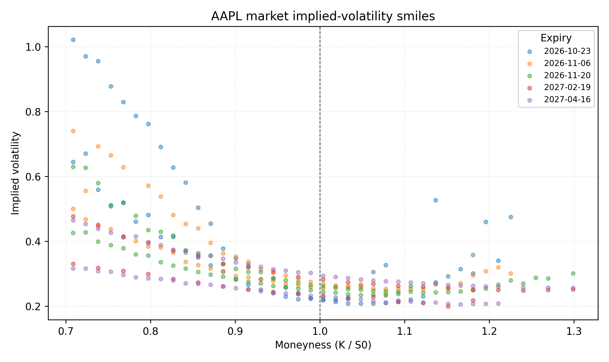
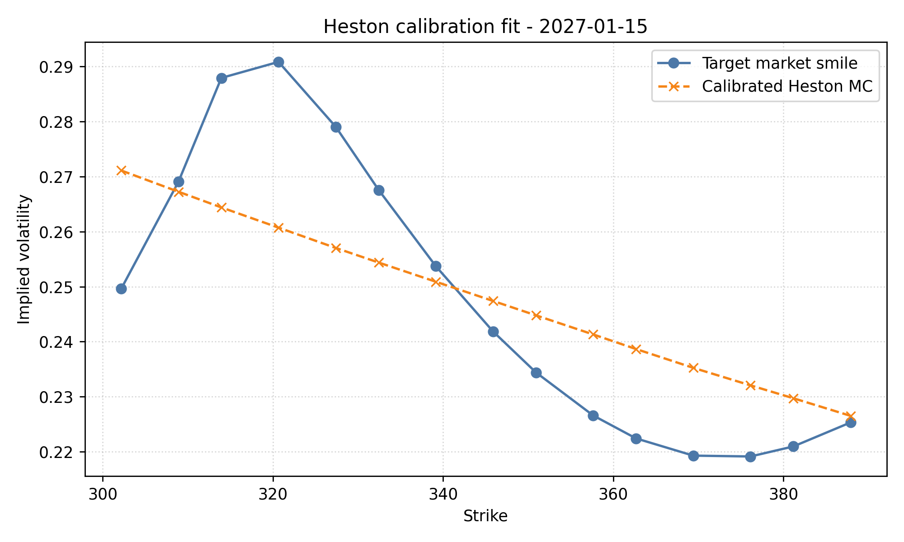
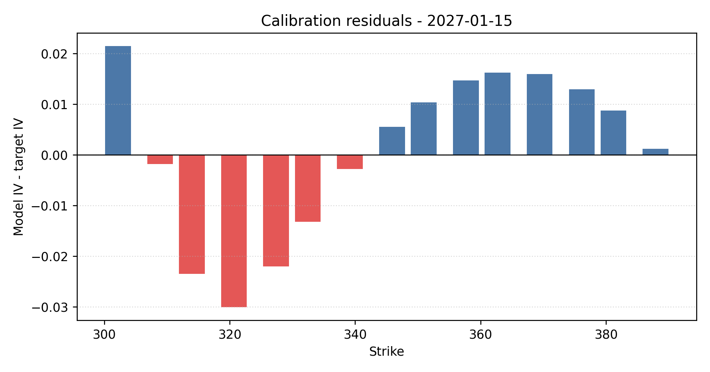

# Heston Stochastic Volatility: Calibration to Equity Option Data

I started this project because I wanted to understand how stochastic-volatility models explain features of option prices that Black-Scholes cannot, especially the implied-volatility smile. I used listed AAPL option data to construct an observed volatility smile and then compared it with a Heston model calibrated using Monte Carlo pricing.

My focus was not only on getting fitted parameters. I also wanted to understand the numerical behavior of the calibration, the residual errors, and which Heston parameters can realistically be identified from one option cross-section.

## Research Question

The main question I wanted to answer was:

Can the Heston stochastic-volatility model reproduce the shape of an observed equity-option implied-volatility smile, and what can the fitted parameters and calibration residuals tell me about the underlying volatility dynamics and the limitations of the model?

To answer that, I needed to move through the full chain from option quotes to model residuals: cleaning market data, converting prices into implied volatilities, using Black-Scholes as a diagnostic benchmark, implementing Heston Monte Carlo pricing, and calibrating the model to a market smile.

## Data

| Item | Value |
| --- | --- |
| Underlying | AAPL |
| Source | Yahoo Finance via `yfinance` |
| Snapshot saved | 2026-10-08 21:43 IST |
| Spot used | 338.72 |
| Clean observations | 592 |
| Expiries retained | 10 |
| Expiry range | 2026-10-23 to 2027-04-16 |
| Calibration expiry | 2027-01-15 |
| Calibration moneyness range | 0.89 to 1.15 |

The option chain needed cleaning before the implied-volatility surface could be analyzed meaningfully. I used midpoint prices, required positive open interest, filtered extreme moneyness, and kept implied volatilities within the range already used by the project.

## Methodology

### 1. Market Data and Implied Volatility

I first cleaned the option chain and converted observed option prices into Black-Scholes implied volatilities. This gives a common scale for comparing options across strikes and makes the volatility smile directly visible.

The cleaned data still reflects real market imperfections: missing or unusable quotes, liquidity differences, and noisy implied-volatility estimates. I smooth the smiles by expiry and combine them into an implied-volatility surface over moneyness and maturity.

### 2. Black-Scholes Diagnostics

I use Black-Scholes as the baseline model, not as the final explanation of the smile. It is useful for implied-volatility inversion, quote checks, Greeks, and simple scenario analysis.

The observed strike dependence of implied volatility is exactly why I moved beyond a flat-volatility model. Black-Scholes gives the diagnostic language; Heston is the stochastic-volatility model I then test against the observed smile.

### 3. Heston Monte Carlo

I implemented the Heston stochastic-volatility model using Monte Carlo simulation:

```text
dS_t = (r - q) S_t dt + sqrt(v_t) S_t dW_t^S
dv_t = kappa(theta - v_t) dt + sigma sqrt(v_t) dW_t^v
corr(dW_t^S, dW_t^v) = rho
```

The parameters are:

- `v0`: initial variance
- `theta`: long-run variance
- `kappa`: speed of variance mean reversion
- `sigma`: volatility of variance
- `rho`: correlation between spot and variance shocks

I used Monte Carlo because it makes the stochastic dynamics explicit and gives a direct numerical implementation of the model. It is not the most efficient method for repeated Heston calibration, which is one reason I treat the calibration as an exploratory numerical experiment rather than a production implementation.

One validation step was checking the Black-Scholes limiting case. When `sigma = 0` and `v0 = theta`, the Heston model should collapse to Black-Scholes. In the saved validation run, the Heston Monte Carlo ATM call price differs from the analytical Black-Scholes price by 0.2012, or 0.63%.

### 4. Heston Calibration

I calibrate the five Heston parameters to a selected AAPL implied-volatility smile. The comparison is made in implied-volatility space, and the objective is the mean squared error between model-implied and market-implied volatilities.

The calibration is intentionally limited: it uses one maturity and a moderate Monte Carlo setup. That makes the fitted residuals and weakly identified parameters part of the result rather than something to hide.

## Results

The cleaned AAPL option data shows visible strike dependence in implied volatility. This is the feature I wanted the Heston calibration to address.



For the canonical run, I calibrated the model to the central part of the AAPL smile for the 2027-01-15 expiry. The target uses 15 strikes with moneyness from 0.89 to 1.15.



The calibrated curve matches the broad volatility level of the selected smile, but it does not fully reproduce the local hump around the lower-middle strikes.

| Metric | Value |
| --- | ---: |
| IV RMSE | 0.0157 |
| IV MAE | 0.0134 |
| Max absolute IV residual | 0.0301 |

| Parameter | Interpretation | Calibrated value |
| --- | --- | ---: |
| `v0` | Initial variance | 0.0708 |
| `kappa` | Mean-reversion speed | 2.0000 |
| `theta` | Long-run variance | 0.0423 |
| `sigma` | Volatility of variance | 0.3000 |
| `rho` | Spot/variance correlation | -0.7000 |

The residual plot shows that the errors are not just random noise around zero. They have visible structure across strikes, with the largest absolute residual near the 321 strike.



The full run record is saved in `reports/run_summary.md`, and the supporting metrics are saved in `reports/canonical_run_metrics.json`.

## Discussion

The Heston fit captures the broad volatility level of the selected smile, but it does not fully reproduce the local curvature. The target smile rises around the lower-middle strikes and then falls through the center of the selected range. The calibrated Heston curve is smoother, so it misses part of that local shape.

The residuals are structured across strikes. The model under-fits the local hump around strikes 314 to 327 and over-fits much of the right side of the smile. That pattern suggests more than pure Monte Carlo noise; it points to either model misspecification, limited flexibility from a single maturity, or the effect of noisy market quotes.

A negative `rho` is economically consistent with the leverage effect often observed in equity markets: downside spot moves tend to be associated with higher variance. In this calibration, however, I would not interpret `rho` too strongly because the optimizer did not move all parameters substantially away from their starting values.

The fitted `v0` is above `theta`, which can be interpreted as the fitted model assigning higher near-term variance than long-run variance. That is a useful way to read the result, but it should be treated cautiously because the calibration is based on one maturity rather than a full term structure.

The fact that `kappa`, `sigma`, and `rho` remain at their starting values is itself informative. A single option smile does not contain enough information to estimate every Heston parameter reliably, and several parameter combinations can produce similar implied-volatility shapes.

## Repository Structure

```text
.
├── README.md
├── requirements.txt
├── notebooks/
│   ├── 00_original_exploration.ipynb
│   ├── 01_data_and_option_surface.ipynb
│   ├── 02_black_scholes_greeks_and_scenarios.ipynb
│   ├── 03_heston_monte_carlo.ipynb
│   └── 04_heston_calibration.ipynb
├── src/
│   ├── data.py
│   ├── black_scholes.py
│   ├── validation.py
│   ├── heston.py
│   ├── calibration.py
│   └── plotting.py
├── data/
│   ├── raw/
│   ├── processed/
│   └── sample/
├── reports/
│   ├── figures/
│   ├── calibration_residuals.csv
│   ├── canonical_run_metrics.json
│   └── run_summary.md
└── tests/
    ├── test_black_scholes.py
    └── test_heston.py
```

`notebooks/00_original_exploration.ipynb` is the earlier exploratory version of the work. The cleaner reviewer path is notebooks `01` through `04`, which separate the workflow into data preparation, Black-Scholes diagnostics, Heston simulation, and calibration.

## Running the Project

```bash
python -m venv .venv
source .venv/bin/activate
pip install -r requirements.txt
```

Recommended notebook order:

1. `notebooks/01_data_and_option_surface.ipynb`
2. `notebooks/02_black_scholes_greeks_and_scenarios.ipynb`
3. `notebooks/03_heston_monte_carlo.ipynb`
4. `notebooks/04_heston_calibration.ipynb`

The saved sample data under `data/sample/` lets the later notebooks run without needing to fetch a fresh option chain first. To refresh the market data, rerun notebook `01`.

## What I Learned from the Project

Market data needs more cleaning than the theory usually suggests. Midpoint construction, liquidity filters, parity checks, and noisy quotes all matter before the model calibration step even begins.

The volatility smile makes the limitation of constant-volatility Black-Scholes much more concrete. Black-Scholes is still useful as a baseline and diagnostic tool, but the smile itself is evidence that one volatility input is not enough to describe the market.

Calibration is not just about finding an optimizer minimum. I found that residuals, parameter interpretation, simulation noise, and the selected calibration region all affect how much meaning I should attach to the final parameter values.

## Limitations

- The data comes from `yfinance`, which is useful for this project but not institutional-quality options data.
- The current calibration focuses on a single implied-volatility smile rather than jointly fitting the full surface.
- Monte Carlo calibration introduces simulation noise and is slower than semi-closed-form Heston pricing.

## Possible Extensions

- Calibrate across multiple expiries instead of a single smile.
- Compare the Monte Carlo pricer with the semi-closed-form Heston solution.
- Test parameter stability across different market dates.

## Final Note

This started as a smaller options-pricing exercise and became a deeper project as I got more interested in volatility modelling. My main goal was to understand the full path from market option quotes to implied volatility, stochastic-volatility simulation, and calibration, rather than only using a pre-built pricing library.
